<div align="center">

<picture>
  <source media="(prefers-color-scheme: dark)" srcset=".github/assets/banner-dark.svg">
  
</picture>

**Native charts described once in PHP and painted by the platform.**<br>
Line, area, bar, donut, sparkline and progress ring, drawn as bounded display lists on pam-native-canvas: no per-frame PHP calls.

[](https://packagist.org/packages/pushinbr/pam-native-charts)

[](https://github.com/push-in/pam-native-charts/actions/workflows/ci.yml)
[](LICENSE)

[Install](#install) · [Quick example](#quick-example) · [Platforms](#platform-support) · [Charts guide](docs/charts.md) · [Docs](#docs) · [Issues](https://github.com/push-in/pam-native-charts/issues)

</div>

<a id="install"></a>
## <picture></picture> Install

Inside a PAM Native project, add only this capability:

```sh
pam composer require pushinbr/pam-native-charts
pam doctor --fix
```

New to PAM? Install the CLI and create a project first:

```sh
curl --proto '=https' --proto-redir '=https' --tlsv1.2 \
    --connect-timeout 15 --max-time 60 --max-filesize 1048576 -fsSL \
    https://github.com/push-in/pam/releases/latest/download/install.sh | sh
pam init my-app --template native
cd my-app
```

This package depends on [`pushinbr/pam-native-canvas`](https://github.com/push-in/pam-native-canvas), which Composer installs with it; `pam doctor --fix` regenerates the native integration.

<a id="quick-example"></a>
## <picture></picture> Quick example

```php
use Pam\Native\Charts\Curve;
use Pam\Native\Charts\LineChart;
use Pam\Native\Charts\Series;

return LineChart::make(width: 328, height: 160)
    ->series(Series::make('Income', [120.5, 80, 140, 90, 200]))
    ->labels(['Mon', 'Tue', 'Wed', 'Thu', 'Fri'])
    ->curve(Curve::Monotone)
    ->area();
```

Every chart is an immutable, fluent builder and a `Renderable`: return it from a screen or component, or place the tag in a template. `view()` exposes the underlying `CanvasView` and `scene()` the raw display list for tests. Each chart type, its template tag and every option are in the [charts guide](docs/charts.md).

<a id="platform-support"></a>
## <picture></picture> Platform support

| Platform | Support | Notes |
| --- | --- | --- |
| Android | API 26+ | Rendered by `pam-native-canvas` (Android Canvas) |
| iOS | 15.0+ | Rendered by `pam-native-canvas` (Core Graphics) |
| PAM Native | ^1.13 | From `composer.json`; `pam-native-canvas` ^0.2; PHP 8.5+ |

<a id="requirements"></a>
## <picture></picture> Requirements

This package is PHP-only (no `pam-native.plugin.json`, no native code, no permissions). Rendering and the Android API 26+ / iOS 15+ floor come from [`pam-native-canvas`](https://github.com/push-in/pam-native-canvas).

<a id="design-rules"></a>
## <picture></picture> Design rules

The charts follow one small visual system so they read as a family and stay legible without color:

- **Thin marks.** Lines are 2 dp, bars have a 4 dp rounded far end anchored to the baseline with at least 2 dp between neighbours, markers are 8 dp, grid lines are 1 dp dashed at 12% ink.
- **One value axis.** Tick labels sit left of the plot; there is never a dual axis. Ticks use "nice" 1-2-5 steps and the domain always includes zero.
- **One hue per job.** Series take colors from a fixed-order categorical palette (or `ChartPalette::sequential()` for magnitudes). Status colors (success, warning, danger) are never used for series identity.
- **Readable without color.** `ChartTheme` carries `ink` and `muted` colors for labels; legends and `valueLabels()` carry series identity in text.
- **Everything in dp.** Charts receive an explicit `width`/`height` and emit a dp scene (`CanvasView::dp()`); pointer coordinates arrive in dp too.
- **Empty states.** Charts without values draw the baseline and a muted "Sem dados" ("No data") label. Single points are drawn as markers.

<a id="production-checklist"></a>
## <picture></picture> Production checklist

- Give every chart an explicit `width`/`height` in dp that matches its layout slot.
- Format values with `valueFormatter()` so ticks and labels use the product's locale.
- Keep status colors out of series; carry identity through labels and legends.
- Re-render with `highlight()` from `onSelect` instead of mutating the chart.
- Run `pam doctor`, `pam test`, and a signed release build on every supported platform.

<a id="troubleshooting"></a>
## <picture></picture> Troubleshooting

- **Nothing is drawn:** make sure `pushinbr/pam-native-canvas` 0.2+ is installed and `pam doctor --fix` regenerated the native integration.
- **Labels overlap:** widen the chart, shorten `labels()`, or lower `grid()`.
- **The highlight does not move:** store the index from `onSelect` in component state and pass it back through `highlight()`.
- **Template props ignored:** bind arrays with `:series="[...]"`; plain attributes are strings and only scalars are coerced.

<a id="security"></a>
## <picture></picture> Security

Security vulnerabilities should be reported through the repository security policy or GitHub private vulnerability reporting, not a public issue.

<a id="docs"></a>
## <picture></picture> Docs

- [Charts guide](docs/charts.md): themes, every chart type, template tags, composition and the API table
- [examples/WeeklyMovement.pam](examples/WeeklyMovement.pam): a finance card with a grouped bar chart (tap highlight), a sparkline and a donut, written as a `.pam` component
- [examples/builder.php](examples/builder.php): the same charts from PHP builders, with a theme, a value formatter and a progress ring
- [Plugin and native capability model](https://push-in.github.io/pam-docs/native/plugins/)
- [Contributing](docs/contributing.md)
- [PAM Native overview](https://push-in.github.io/pam-docs/native/overview/)
- [PAM introduction](https://push-in.github.io/pam-docs/introduction/)
- [Changelog](CHANGELOG.md)
- [Report an issue](https://github.com/push-in/pam-native-charts/issues)

<a id="pam-ecosystem"></a>
## <picture></picture> Part of the PAM ecosystem

PAM runs PHP natively on servers, desktops and phones. This repository is one piece of it.

| [**PAM**](https://github.com/push-in/pam) | [**PAM Desktop**](https://github.com/push-in/pam-desktop) | [**PAM Native**](https://github.com/push-in/pam-native) | [**Ecosystem**](https://github.com/push-in/pam#ecosystem) |
| --- | --- | --- | --- |
| the runtime and CLI | native desktop apps in PHP | native Android and iOS apps in PHP | every official package and plugin |

<sub>Docs: [push-in.github.io/pam-docs](https://push-in.github.io/pam-docs/introduction/) · [Issues](https://github.com/push-in/pam-native-charts/issues)</sub>

<p align="center"><sub><a href="LICENSE">Apache License 2.0</a> · Made in Brazil by Pushin</sub></p>
